<!-- ═══════════════ HEADER ═══════════════ -->
<div align="center">


<a href="https://github.com/Abhayp56">
  
</a>

<br/>



<br/><br/>


</div>

<br/>

<!-- ═══════════════ ABOUT ═══════════════ -->
<h2 align="center">⟨ 🧬 ABOUT.ME ⟩</h2>

<div align="center">

```yaml
name:      Abhay Patil
handle:    Abhayp56
roles:
  - AI App Builder
  - Full Stack Builder
  - AI Agents Builder
studying:  Energy Engineering
building:  [voice assistants, AI agents, mobile + web apps]
powered_by: [Gemini, Python, React, curiosity]
motto:     "Build fast. Learn faster. Ship something real."
```

</div>

<br/>

<!-- ═══════════════ TECH ═══════════════ -->
<h2 align="center">⟨ ⚙️ TECH.STACK ⟩</h2>

<div align="center">


<br/><br/>


</div>

<br/>

<!-- ═══════════════ PROJECTS ═══════════════ -->
<h2 align="center">⟨ 🚀 PROJECTS.EXE ⟩</h2>

<div align="center">

<a href="https://github.com/Abhayp56/SPIDY-AI">
  
</a>

</div>

<br/>

<table align="center">
  <tr>
    <td width="50%" valign="top">
      <h3>🎙️ ARYA</h3>
      <p>Voice assistant that listens, thinks and talks back, powered by LLMs and real-time voice.</p>
      
      
      
    </td>
    <td width="50%" valign="top">
      <h3>🕷️ S.P.I.D.Y. AI</h3>
      <p>Gemini Live voice assistant for Windows with a Dynamic Island / Orb style HUD.</p>
      
      
      
    </td>
  </tr>
  <tr>
    <td width="50%" valign="top">
      <h3>💞 Bondly</h3>
      <p>Mobile app built around connecting people and making relationships easier.</p>
      
      
    </td>
    <td width="50%" valign="top">
      <h3>🧭 Campus Navigator</h3>
      <p>App that helps students find their way around campus without getting lost.</p>
      
      
    </td>
  </tr>
  <tr>
    <td width="50%" valign="top">
      <h3>📊 Marketing AI Reporter</h3>
      <p>AI agent that turns raw marketing data into clear, readable reports.</p>
      
      
    </td>
    <td width="50%" valign="top">
      <h3>🔒 NEXT_PROJECT</h3>
      <p><code>loading...</code> Something new is always in the pipeline.</p>
      
    </td>
  </tr>
</table>

<br/>

<!-- ═══════════════ STATS ═══════════════ -->
<h2 align="center">⟨ 📡 GITHUB.STATS ⟩</h2>

<div align="center">


<br/>


<br/><br/>


<br/><br/>


</div>

<br/>

<!-- ═══════════════ CURRENTLY ═══════════════ -->
<h2 align="center">⟨ 🎯 CURRENTLY ⟩</h2>

<div align="center">

```diff
+ Building      : AI voice assistants & agents
+ Learning      : advanced full stack + agent architectures
+ Exploring     : AI-powered products & SaaS ideas
+ Open to       : collabs, cool ideas, and building in public
- Sleep         : not found (404)
```

</div>

<br/>

<!-- ═══════════════ CONNECT ═══════════════ -->
<h2 align="center">⟨ 📨 CONNECT ⟩</h2>

<div align="center">

<!-- Replace the URLs below, then delete these comment lines -->
<a href="YOUR_LINKEDIN_URL"></a>
<a href="YOUR_INSTAGRAM_URL"></a>
<a href="mailto:YOUR_EMAIL"></a>

<br/><br/>

```bash
$ echo "Let's build something insane together." && exit 0
```

</div>


